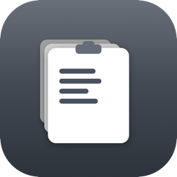
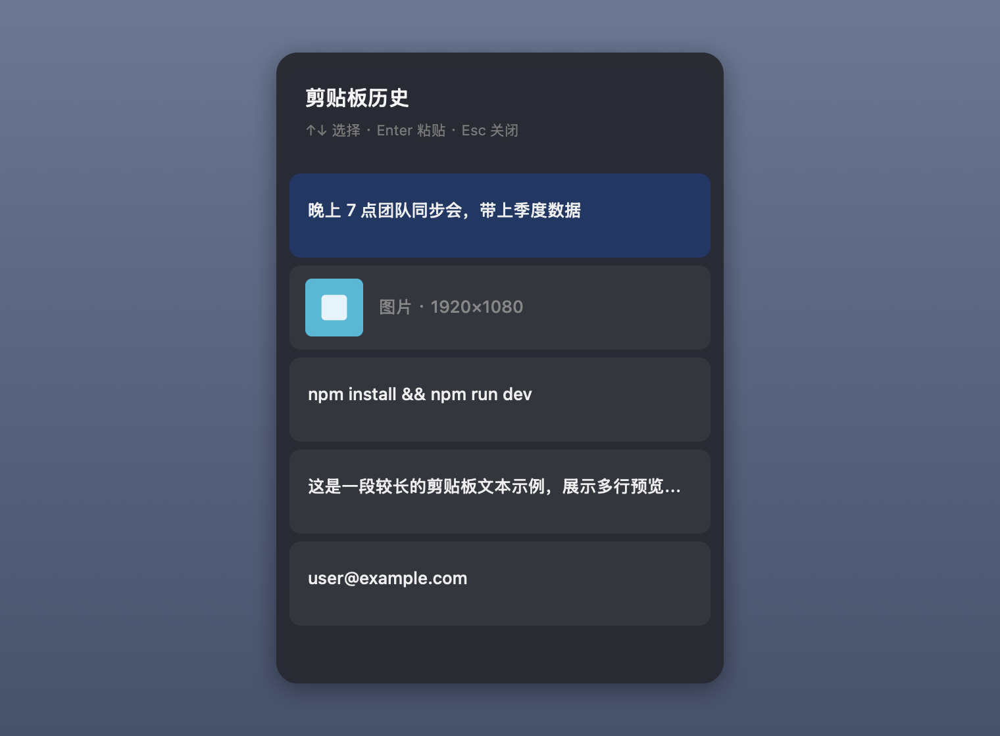

<div align="center">



# Y-Clip

**把 Windows `Win + V` 的剪贴板历史体验，原生搬到 macOS。**

一个轻量、常驻菜单栏的剪贴板历史工具 —— 在任意输入光标旁按下快捷键，即可翻看、选择并自动粘贴最近复制过的文字与图片。也可以把需要反复使用的内容贴在屏幕旁边。

[](https://www.apple.com/macos/)
[](https://www.swift.org/)
[](#-安装)
[](../../releases/latest)



</div>

---

## ✨ 功能

- 📋 **自动记录** 最近复制过的剪贴板内容，默认保留 50 条，数量可在设置里调整
- 🖼️ **文字 + 图片** 都能记录，图片以统一大小的缩略图展示，列表整齐不跳动
- ⌨️ **随手呼出**：默认 `⌥ + ⌘ + V`，在输入光标附近弹出，靠近屏幕边缘自动避让
- 📌 **固定面板**：点击右上角图钉，或用默认 `⌥ + ⇧ + ⌘ + V` 直接打开固定状态；面板保持在普通窗口上方、可拖拽并记住位置，历史变化会实时刷新
- 📎 **单条贴出**：历史文字或图片以无标题栏、无描边的浮窗贴在屏幕上；可拖动、缩放、复制原内容或移除
- 🗂️ **精选面板**：只显示自己从历史挑选或手动填写的条目；长文本可选中任意片段逐条加入，每条都有独立的「复制」按钮
- 🎯 **多种选择方式**：鼠标点击、`↑↓` 方向键、`Enter` 粘贴、`Esc` 关闭；固定状态下选择内容后面板继续显示
- ⚡ **选中即置顶**：选用某条历史后，它会自动成为当前剪贴板内容并排到最前
- 📐 **显示可调**：设置里用滑杆调整历史面板大小、宽度和长度；选择「功能」页时旁侧半透明预览会持续显示并实时更新
- 🔢 **历史上限可调**：可设置最多记录多少条历史，默认 50 条
- 🔄 **自动更新**：可自动检查 GitHub Release，并按当前编译架构精确选择 `Y-Clip-v版本-arm64.dmg` 或 `Y-Clip-v版本-x86_64.dmg`；Release 版本必须严格高于当前版本，下载 App 的内部版本必须完全一致，挂载源、临时副本、同卷候选和最终安装路径都会校验 Bundle ID、Developer ID 团队、hardened runtime、代码签名、Gatekeeper 与 thin 架构。安装使用固定互斥锁和 candidate + backup 原子切换；安装器的 `READY\n` 通道必须随即关闭且不允许尾随内容。新版只有在 AppKit 完成启动、回传随机 token/PID 并继续存活后才提交更新；失败时只恢复并启动已验证的旧版，回滚不完整则保留互斥锁和全部恢复副本供后续处理
- 🎨 **全新图标**：浅色 macOS 风格底板，保留层叠剪切板识别点，并收敛图标视觉尺寸
- 🪶 **不抢焦点**：弹窗不会激活应用，尽量保留你原本的输入框焦点
- 🍎 **原生体验**：菜单栏常驻图标，深色 / 浅色模式自适应，无 Dock 图标打扰

## 📦 安装

### 方式一：下载安装包（推荐）

> 当前公开的 v1.0.20 安装包尚不包含本分支的「单条贴出」和「精选面板」功能；本分支源码标为 1.0.22（23）本地审阅版，尚未正式发布。

1. 根据 Mac 处理器下载 `v1.0.20` 对应安装包：
   - **Apple Silicon（M 系列）**：[Y-Clip-v1.0.20-arm64.dmg](https://github.com/Rainchen537/Y-Clip/releases/download/v1.0.20/Y-Clip-v1.0.20-arm64.dmg)
   - **Intel**：[Y-Clip-v1.0.20-x86_64.dmg](https://github.com/Rainchen537/Y-Clip/releases/download/v1.0.20/Y-Clip-v1.0.20-x86_64.dmg)
2. 双击打开，把 **Y-Clip** 拖进 **应用程序** 文件夹
3. 从启动台或应用程序文件夹打开即可

> ✅ 两个架构的安装包都分别完成 Apple **Developer ID 签名、公证（notarized）与 Gatekeeper 验证**，下载后双击即可打开，**不会出现「无法验证开发者」或「已损坏」的拦截**。
>
> `v1.0.20` 只提供 `arm64` 与 `x86_64` 两个独立 thin DMG，不额外提供 universal DMG。

### 方式二：从源码构建

GitHub 仓库：[Rainchen537/Y-Clip](https://github.com/Rainchen537/Y-Clip)

需要安装 Xcode 命令行工具。

```zsh
git clone https://github.com/Rainchen537/Y-Clip.git
cd Y-Clip
./build.sh                 # 默认构建 arm64 thin app 到 build/Y-Clip.app
TARGET_ARCH=x86_64 BUILD_DIR=build-x86_64 ./build.sh
./install_app.sh           # 安装默认 build/Y-Clip.app 到 /Applications
```

## 🔐 权限说明

首次启动时 Y-Clip 会统一说明所需的 **「辅助功能」** 权限；选择历史记录自动粘贴时，macOS 会要求完成授权 —— 这是模拟 `⌘ + V` 粘贴所必需的，所有同类工具都一样。后续只在运行副本或权限状态变化时提示当前未完成步骤，不会反复弹出完全相同的警告。

> 系统设置 → 隐私与安全性 → 辅助功能 → 勾选 **Y-Clip**

- 如果没有自动弹出，可从菜单栏图标的设置里点 **「辅助功能」** 按钮打开。
- 没有授予权限时，应用仍会把选中内容复制回系统剪贴板，只是不会替你自动粘贴（需要你手动 `⌘V`）。
- 权限页会标明当前运行的是 **「正式安装版」** 还是 **「开发副本」**；若 `/Applications/Y-Clip.app` 的 Bundle ID 和 Developer ID 团队签名均验证通过，可直接点 **「切换到安装版」**，避免权限绑定到临时构建。
- 若系统设置里看起来已开启但仍不生效，**「刷新权限记录」** 只会重置 Y-Clip 自身 Bundle ID 的辅助功能 TCC 记录，不影响其他 App。若操作来自开发副本，Y-Clip 不会立刻为该副本再次请求权限；检测到有效的 `/Applications/Y-Clip.app` 时会切换到正式安装版，并在那里引导重新授权。也可以运行 `./reset_accessibility.sh` 完成同样的定向刷新。

## ⌨️ 使用

| 操作 | 快捷键 |
|------|--------|
| 打开临时历史面板 | `⌥ + ⌘ + V`（可在设置里自定义） |
| 打开固定历史面板 | `⌥ + ⇧ + ⌘ + V`（可独立自定义） |
| 上 / 下选择 | `↑` / `↓` |
| 粘贴选中项 | `Enter` |
| 关闭面板 | `Esc` |
| 打开设置 | 点击菜单栏的剪贴板图标 |

历史面板右上角有「精选」、图钉和齿轮：「精选」打开自选小面板，图钉切换完整历史的固定状态，齿轮打开设置。

历史列表中每条右侧的「操作」菜单可以「单独贴出」「加入精选面板」；文字还可以选择「拆分到精选面板」。精选面板也能从菜单栏图标的「打开精选面板」进入。点击「添加 / 拆分」后粘贴或输入长文本，选中姓名、电话、地址等任意片段并逐条加入；「整段加入」可直接创建一条。条目数量和片段边界由你决定。精选面板可以拖到填写页面旁边，每行「复制」只复制该条内容，复制后面板继续显示。精选条目与面板位置会在重新启动后恢复；单条贴出浮窗关闭后即结束。

单条贴出可直接拖动。鼠标滚轮或键盘 `+` / `-` 缩放；悬停显示「操作」，右键也能打开菜单，选择放大、缩小、复制原内容或移除。移除只关闭这张贴出内容，不会删除历史记录。

在设置面板里可以：分别自定义临时面板与固定面板快捷键、调节历史面板大小/宽度/长度、设置历史上限、开关开机自启、自动检查更新、清空历史、打开辅助功能权限、打开 GitHub 页面。

## 🛠️ 技术

- 纯 **Swift + AppKit**，无第三方依赖
- 全局热键：Carbon `RegisterEventHotKey`
- 自动粘贴：`CGEvent` 键盘事件注入
- 开机自启：`SMAppService`
- 数据：文字与图片元数据仍存于 `~/Library/Application Support/GlobalClipboard/`，用于保持从旧版升级后的历史记录兼容；图片原图单独落盘并按内容去重
- 精选内容另存于 `~/Library/Application Support/GlobalClipboard/curated/`；精选图片有独立副本，普通历史清理不会影响它

本分支的精选存储与拆分测试：`./test_curated_clipboard.sh`。

## 📄 许可

MIT License

---

<div align="center">
<sub>用 ❤️ 为 macOS 打造</sub>
</div>

友情链接：[Linux.do](https://linux.do/)
